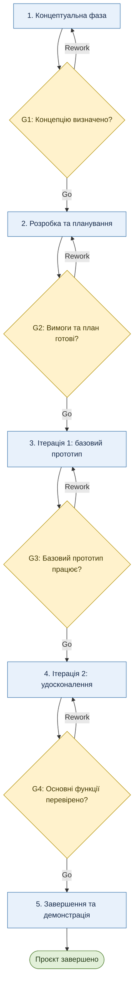

# Життєвий цикл проєкту UniGuide

## 1. Обрана модель життєвого циклу
* **Конкретна модель:** макетування.
* **Тип моделі за сучасною класифікацією:** ітеративна.

### Обґрунтування вибору
Для проєкту UniGuide обрано модель макетування, оскільки продукт є невеликим навчальним вебзастосунком, вимоги до якого можуть уточнюватися під час розробки. Створення прототипу дає змогу перевірити структуру інтерфейсу, зручність пошуку менторів і зрозумілість основних користувацьких сценаріїв ще до завершення реалізації. Ітеративний підхід дозволяє поступово вдосконалювати продукт відповідно до результатів перевірки. Модель також підходить для виконання, оскільки дає змогу розподілити роботу на невеликі етапи та контролювати навантаження.

---

## 2. Фази життєвого циклу

| № | Назва фази | Мета фази | Тривалість (тижнів) | Ключові роботи | Deliverables (проміжні результати) | Відповідальний |
|:---:|:---|:---|:---:|:---|:---|:---|
| **1** | Концептуальна (ініціація) | Визначити проблему, цільову аудиторію та основну ідею продукту. | 1 | Аналіз потреб першокурсників, формулювання мети, визначення основних функцій і зацікавлених сторін. | `project-brief.md`, опис проблеми, визначена цільова аудиторія. | Крецу Владислав Сергійович |
| **2** | Розробка та планування | Визначити вимоги, структуру продукту та план реалізації. | 1 | Уточнення функціональних вимог, аналіз аналогів, вибір інструментів, планування ітерацій, створення початкового макета інтерфейсу. | `project-classification.md`, перелік вимог, початковий макет, план робіт. | Крецу Владислав Сергійович |
| **3** | Виконання — ітерація 1 | Створити початковий прототип із базовою структурою та основними екранами. | 2 | Реалізація структури вебзастосунку, сторінок профілю, каталогу менторів і початкової навігації. Перевірка зручності інтерфейсу. | Початковий прототип, базові сторінки, результати первинної перевірки. | Крецу Владислав Сергійович |
| **4** | Виконання — ітерація 2 | Удосконалити прототип і реалізувати пріоритетні функції. | 2 | Реалізація пошуку та фільтрації менторів, форми запиту на менторство, перевірка основних сценаріїв, виправлення виявлених помилок. | Удосконалений прототип, реалізовані пріоритетні функції, результати тестування. | Крецу Владислав Сергійович |
| **5** | Завершення | Перевірити результат, підготувати документацію та представити продукт. | 1 | Фінальне тестування, виправлення критичних помилок, перевірка документації, підготовка демонстрації та підбиття підсумків. | Готовий навчальний прототип, актуальна документація, підсумковий звіт і демонстрація. | Крецу Владислав Сергійович |

* **Загальна планова тривалість:** 7 тижнів.
* *Зазначені строки є попередньою оцінкою та можуть змінюватися залежно від навчального навантаження і складності реалізації. Фази виконання передбачають повторне уточнення вимог за результатами перевірки прототипу.*

---

## 3. Ворота між фазами

| Ворота | Між фазами | Критерії переходу | Можливі рішення |
|:---:|:---|:---|:---:|
| **G1** | Концептуальна → Розробка та планування | Сформульовано проблему, визначено цільову аудиторію, мету продукту та основні функції. | Go / Rework / Kill |
| **G2** | Розробка та планування → Виконання, ітерація 1 | Визначено вимоги, складено план робіт, обрано інструменти та підготовлено початковий макет. | Go / Rework / Kill |
| **G3** | Ітерація 1 → Ітерація 2 | Створено базову структуру вебзастосунку, основні сторінки доступні, навігація працює, критичні помилки відсутні. | Go / Rework / Kill |
| **G4** | Ітерація 2 → Завершення | Реалізовано пріоритетні функції, основні користувацькі сценарії перевірено, критичні помилки виправлено. | Go / Rework / Kill |

*Рішення **Go** означає перехід до наступної фази, **Rework** — повернення до доопрацювання поточного етапу, а **Kill** — припинення проєкту, якщо його подальша реалізація недоцільна. Для навчального проєкту припинення розглядається як крайній варіант.*

---

## 4. Візуалізація життєвого циклу

## 5. Обґрунтування вибору моделі

На вибір моделі вплинули невеликий масштаб UniGuide, навчальний характер проєкту, обмежені ресурси та середній рівень невизначеності вимог. Основні можливості продукту вже визначені, але їхня зручність і достатність можуть стати зрозумілими лише після створення та перевірки прототипу. Тому доцільно використовувати модель макетування з ітеративним уточненням продукту.

Серед альтернатив розглядалася каскадна модель Waterfall, яка передбачає послідовне виконання фаз і значну увагу до попереднього визначення вимог. Вона могла б бути корисною за повністю стабільних вимог, проте в цьому проєкті зміни інтерфейсу та функціональності є очікуваними. Також можна розглядати Scrum, однак для індивідуального навчального проєкту його повна організаційна структура з ролями, подіями та командними домовленостями створює зайві накладні витрати.

Основними перевагами обраної моделі є можливість рано отримати видимий результат, виявити проблеми інтерфейсу та поступово вдосконалювати продукт. Поділ виконання на дві ітерації дозволяє спочатку зосередитися на структурі застосунку, а потім додати пріоритетні функції. Ворота між фазами забезпечують контроль результатів і допомагають не переходити до наступного етапу, якщо попередній ще не готовий.

Водночас модель має ризики. Неодноразове вдосконалення макета може збільшити строки, а обмежений досвід реалізації окремих функцій може призвести до технічних труднощів. Щоб мінімізувати ці ризики, необхідно визначити мінімальний обсяг першої версії, фіксувати результати кожної ітерації, перевіряти основні сценарії та відкладати другорядні можливості наступних версій.

У подальшій роботі планується уточнити вимоги до UniGuide, створити початковий макет, реалізувати базову структуру вебзастосунку, а потім поступово додати пошук менторів і надсилання запитів. Наприкінці буде проведено тестування основних сценаріїв, підготовлено документацію та представлено результат. Такий підхід дасть змогу контролювати обсяг робіт і водночас зберегти можливість змінювати продукт за результатами перевірки.
